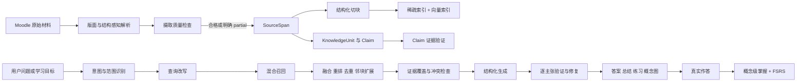

# Askme Learning Kernel

> 状态：产品内核规范  
> 适用范围：UNSW Moodle 课程同步、理解、总结、问答、练习与掌握评估  
> 约束：本文件定义 Askme 的唯一学习内核。界面、今日计划、提醒和快捷入口必须消费本内核产生的数据，不得反向决定内容如何被理解或验证。

## 0. P0 第一阶段实现状态（2026-10-01）

本阶段已落地数据内核和摄取边界，当前扩展与服务版本为 `1.6.0 · 2026.10.02.1` / `2026.10.02.1`：

- `extension/assessment-kernel.js` 是不读取 DOM、storage 或模型的 UMD 纯函数模块。它规范化并校验 `EvidenceRef`，从考核表行和安全 assignment intro block 构建 `Requirement`，区分 `explicit`、`candidate`、`gap` 覆盖，生成带 schema 的 `PreparationSnapshot`，并用执行门输出 `current`、`stale`、`conflict`、`needsReview` 以及 `confirmed`、`partial`、`unknown`。候选关系不计入 confirmed。
- `content.js` 为考核表行增加确定性 `sourceVersion`、行序号和 evidence span，为安全 brief block 增加字符范围。原有唯一 `#region-main .activity-description #intro` 边界保持不变，提交、attempt、成绩和反馈 DOM 仍失败关闭。
- `knowledge-units.js` 升级到 schema 2。分句不再切断 `0.5`、`1.2`、`3.14`，每个知识单元保存可证明的精确 covered range；定义或公式之外的条件、步骤和限制作为 residual learning span 保留。schema 1 单元标为 stale，在下一次可靠同步时重建，不能冒充 current。
- `panel.js` 只消费 current KU；同页已有 KU 时继续生成未覆盖残余卡片。歧义、冲突或不安全的 brief 关联不再走同名回退。CoverageLink 只接受要求原文与课程原文共享、且课程材料明确 mapped/aligned/assessed 的 CLO 关系；同课程任意证据不能成为 explicit。整课同步会持久化不含正文或答案的最小 PreparationSnapshot，Assessment Workspace 与考核定向练习会按当前来源重验执行门。

尚未贯通：一般课程材料尚未全部升级为统一 `SourceArtifact` / `SourceSpan`；非 CLO 的课程材料到 requirement 语义关系仍失败关闭；本阶段没有进行真实 Chrome 或真实课程验收，也没有生成安装包。

## 1. 第一性目标

Askme 的目标是把学生有权访问的 Moodle 原始材料，转化为**准确、可验证、结构清楚、能够迁移到 assessment、quiz 和 exam 的知识**。

产品优先级固定为：

1. 完整、正确地读取课程材料。
2. 找到回答当前问题所需的原文证据。
3. 让每个事实、公式、条件和考核要求都能回到具体来源。
4. 将分散材料提炼成概念、关系、步骤、公式、条件、例子和误区。
5. 用高质量练习验证学生是否能回忆、解释和迁移知识。
6. 根据真实作答表现维护概念级掌握状态。
7. 在以上数据可靠后，安排学习顺序、提醒和时间计划。

“少操作”和“现在学什么”是体验优化，不是学习内核的质量标准。任何减少操作的设计，如果降低了材料覆盖、答案正确性、引用可核验性或练习质量，都不得采用。

### 1.1 成功定义

Askme 成功时，学生能够：

- 快速得到基于自己课程材料的解释，并逐项检查依据。
- 在长讲义、多份 slides、网页和课程文件之间建立正确的概念联系。
- 看见公式的变量、适用条件、限制和典型错误，而不只得到一句结论。
- 通过与课程知识一致的原创练习发现薄弱点。
- 区分“课程原文明确说明”“根据材料归纳”“Askme 自拟例子”和“当前材料无法确认”。
- 在 assessment、quiz 和 exam 前按知识组件检查准备程度。

### 1.2 非目标与边界

- 不自动作答或提交正在进行的正式测验、作业或考试。
- 不把模型常识伪装成课程事实。
- 不根据标题、频率或模型猜测虚构考核权重。
- 不把打开页面、阅读时长、展开答案或主观点击“懂了”直接等同于掌握。
- 不复制 AskSia 的专有代码、品牌、图标、文本或受保护资产。

## 2. 可信度层级

所有学习输出必须标记其可信度来源。

| 层级 | 含义 | 输出要求 |
|---|---|---|
| `explicit` | 课程材料直接陈述 | 必须引用原始 `SourceSpan` |
| `derived` | 可由多个原文证据直接归纳或推导 | 必须引用全部关键证据，并说明是归纳或推导 |
| `example` | Askme 为帮助理解而自拟 | 明示“自拟例子”，不得伪造课程引用 |
| `inferred` | 关于可能考法、重要性或关联的产品推断 | 明示“推断”，不得写成课程要求 |
| `insufficient` | 当前材料不足、冲突或解析不完整 | 说明缺失范围，展示最相关原文或建议同步材料 |

涉及公式、数值、截止时间、评分规则、assessment 要求的内容，只允许使用 `explicit` 或经过完整证据链验证的 `derived`。

## 3. 核心数据模型

所有 ID 在同一账户命名空间内稳定；课程重新同步时，未变化对象保持 ID，变化对象通过版本关系连接。

### 3.1 原始来源

```ts
type SourceArtifact = {
  id: string;
  accountId: string;
  courseId: string;
  moodleModuleId?: string;
  type: "html" | "pdf" | "pptx" | "docx" | "xlsx" | "image" | "audio" | "video" | "text";
  title: string;
  url: string;
  versionHash: string;
  syncedAt: string;
  parseStatus: "complete" | "partial" | "failed";
  expectedUnits?: number;
  parsedUnits?: number;
  coverage: number | null;
  warnings: string[];
};
```

### 3.2 可定位原文

```ts
type SourceSpan = {
  id: string;
  artifactId: string;
  courseId: string;
  page?: number;
  slide?: number;
  timestampStartMs?: number;
  timestampEndMs?: number;
  sheet?: string;
  cellRange?: string;
  headingPath: string[];
  blockType: "heading" | "paragraph" | "list" | "table" | "formula" | "caption" | "transcript";
  charStart: number;
  charEnd: number;
  text: string;
  hash: string;
};
```

`SourceSpan` 是引用的最小稳定单位。回答中显示的页码、slide、时间戳和原文摘录均由它产生。

### 3.3 检索块

```ts
type EvidenceChunk = {
  id: string;
  artifactId: string;
  courseId: string;
  spanIds: string[];
  headingPath: string[];
  text: string;
  tokenCount: number;
  previousId?: string;
  nextId?: string;
  keywords: string[];
  embeddingModel: string;
  embedding?: string;
  versionHash: string;
};
```

### 3.4 知识组件

```ts
type KnowledgeUnit = {
  id: string;
  courseId: string;
  type: "definition" | "concept" | "procedure" | "formula" | "example" | "misconception" | "comparison";
  canonicalName: string;
  aliases: string[];
  claimIds: string[];
  prerequisiteIds: string[];
  relatedIds: string[];
  sourceVersionHashes: string[];
  status: "verified" | "partial" | "conflict" | "stale";
};

type Claim = {
  id: string;
  knowledgeUnitId: string;
  text: string;
  evidenceSpanIds: string[];
  confidence: number;
  trustLevel: "explicit" | "derived" | "example" | "inferred" | "insufficient";
  verification: "verified" | "unsupported" | "conflict";
};
```

知识组件不得只有模型生成文本。每个课程事实 Claim 必须能追溯到 `SourceSpan`。

### 3.5 考核目标

```ts
type AssessmentObjective = {
  id: string;
  courseId: string;
  assessmentId?: string;
  verb: string;
  topic: string;
  conditions: string[];
  evidenceSpanIds: string[];
  explicitWeight?: number;
  sourceVersionHashes: string[];
};
```

只有 assessment brief、course outline、rubric 或教师材料明确说明时，才能保存 `explicitWeight`。材料未说明时保持空值。

### 3.6 练习与掌握

```ts
type PracticeItem = {
  id: string;
  courseId: string;
  knowledgeUnitIds: string[];
  bloomLevel: "remember" | "understand" | "apply" | "analyze" | "evaluate" | "create";
  type: "short-answer" | "mcq" | "calculation" | "explanation" | "comparison" | "scenario";
  stem: string;
  options?: string[];
  answer: string;
  rubric: string[];
  distractorRationales?: string[];
  evidenceSpanIds: string[];
  sourceVersionHashes: string[];
  validation: PracticeValidation;
};

type PracticeValidation = {
  answerable: boolean;
  uniqueCorrectAnswer: boolean;
  evidenceComplete: boolean;
  copiedFromAssessment: boolean;
  bloomMatch: boolean;
  validatorNotes: string[];
};

type MasteryState = {
  knowledgeUnitId: string;
  attempts: number;
  correctWithoutHint: number;
  hintLevelLast: 0 | 1 | 2 | 3;
  errorTags: string[];
  fsrsDifficulty: number;
  fsrsStability: number;
  retrievability: number;
  dueAt: string;
  lastAttemptAt?: string;
  evidenceVersionHashes: string[];
  status: "unseen" | "learning" | "weak" | "stable" | "needsRevalidation";
};
```

## 4. 端到端学习管线



## 5. 摄取 Pipeline

### 5.1 获取与版本控制

1. 只读取用户已登录且主动选择的 UNSW Moodle 课程。
2. 为每个 Moodle module、页面和文件保存稳定来源 ID。
3. 记录 HTTP/页面状态、同步时间、文件类型、字节 hash 和内容 hash。
4. 同步先写入临时快照，通过校验后原子替换正式快照。
5. 失败或部分成功时保留上次成功版本，并明确指出哪些内容未更新。

### 5.2 文档类型感知解析

- HTML：保留标题层级、列表、表格、链接文字和 module/section 关系。
- PDF：保留页码、阅读顺序、标题、段落、表格、公式、图注；扫描页进入 OCR。
- PowerPoint：以 slide 为基本定位，保留标题、正文、speaker notes、表格和图片 OCR。
- Word：保留 heading、段落、表格、列表和图注。
- Excel/CSV：保留 sheet、cell range、表头和行列关系，避免把表格压平成无结构文本。
- 音视频：使用带时间戳转录；如果存在官方 transcript，优先官方版本。

### 5.3 摄取质量检查

每个 `SourceArtifact` 必须计算：

- 预期页数、slide 数或 sheet 数与实际解析数。
- 空页和异常短页比例。
- 乱码、控制字符和重复文本比例。
- 截断、下载失败、密码保护、OCR 失败和不支持格式。
- 表格、公式、图像型页面是否可能丢失关键信息。
- 文档标题、section 和来源 URL 是否可回查。

`parseStatus=partial` 的内容可以进入检索，但回答必须显示覆盖风险。失败内容不得悄悄当作已完整同步。

### 5.4 规范化

- 统一 Unicode、空白和换行，但保留原文用于引用。
- 删除重复 header/footer 时记录规则，不能删除正文中的同名内容。
- 表格生成结构化文本表示，同时保留原 cell 位置。
- 数学符号、上下标、单位和负号不得进行有损替换。
- 所有规范化文本保存到原始 span 的映射。

## 6. 结构化 Pipeline

### 6.1 EvidenceChunk

先按文档结构切分，再按 token 限制二次切分：

1. 优先边界：课程 section、heading、page、slide、段落、列表、表格和公式块。
2. 建议块大小：350–700 tokens；overlap 为 10%–15%。
3. 标题和短小正文合并，避免孤立标题。
4. 公式必须与变量定义、适用条件和紧邻解释共同成块。
5. 表格按表头加相关行组成块，不能将单元格随机断开。
6. 每块记录前后邻居，检索命中后可以扩展上下文。

固定字符窗口只能作为结构解析失败时的降级方案，并必须标记。

### 6.2 KnowledgeUnit 抽取

以一组完整材料为范围，分两阶段处理：

1. 局部抽取：从每个 section 提取定义、概念、步骤、公式、条件、例子、比较和误区。
2. 全局归并：合并同义概念、建立别名、前置知识和关系，保留来源差异。

每个 Claim 必须原子化：一句话只表达一个可以独立验证的事实。抽取器同时输出 `evidenceSpanIds`，验证器确认后才能进入正式知识图谱。

### 6.3 变化传播

材料版本发生变化时：

- 只重建受影响的 span、chunk、Claim、KnowledgeUnit 和 PracticeItem。
- 引用旧版本的练习标记为 stale。
- 对应 `MasteryState` 标记为 `needsRevalidation`，保留历史记录但不继续宣称已掌握最新内容。

## 7. 检索 Pipeline

### 7.1 意图和范围

检索前识别问题类型：

- `fact`：定义、日期、数值、明确规则。
- `explain`：原理、原因、直观解释。
- `compare`：两个或多个概念的相同与差异。
- `procedure`：步骤和操作顺序。
- `formula`：公式、变量、推导、条件和计算。
- `synthesis`：跨 section 或跨文件综合。
- `assessment-prep`：围绕明确考核目标准备。
- `unanswerable-check`：验证材料是否足够回答。

默认限制在当前课程。跨课程检索必须由用户明确选择或在界面清楚显示范围。

### 7.2 查询改写

- 多轮 follow-up 先改写成独立问题，保留课程实体、变量和限定条件。
- 精确数值、公式、文件名、assessment 名称不做语义扩写。
- 综合问题可拆成 2–4 个单概念查询，从“定义、机制、条件、例外、应用”多视角召回。
- 中文提问检索英文材料时，生成英文术语和缩写，但保留原问题共同检索。
- 查询改写输出结构化 JSON，并记录用于调试和评测。

### 7.3 混合召回

每个查询执行：

1. BM25 稀疏召回 top 20。
2. embedding 语义召回 top 20。
3. 通过 Reciprocal Rank Fusion 合并，不直接混合未校准的原始分数。
4. 使用 course、section、week、artifact type、时间和 assessment objective 过滤。
5. 对标题、公式、教师明确标注和 assessment objective 使用可解释的 metadata boost。

### 7.4 重排与上下文组装

1. 对融合后的 20–30 个候选使用 CrossEncoder 重排。
2. 本机无法运行 CrossEncoder 时，使用 Qwen 的结构化相关性评分；评分器不得生成答案。
3. 选择 6–8 个最终块，使用 MMR 或等价策略减少重复。
4. 命中公式、表格或断句位置时扩展相邻块。
5. 检查证据是否覆盖问题的每个子部分。
6. 检测不同材料之间的数值、定义和要求冲突。

重排阈值必须由 MANF9543 金标集校准，不能长期硬编码一个未经评测的 cosine 阈值。

## 8. 生成与总结 Pipeline

### 8.1 生成前证据计划

模型生成面向学生的文字前，先产生内部结构：

```json
{
  "answerable": true,
  "claims": [
    {
      "plannedClaim": "...",
      "evidenceSpanIds": ["span-1"],
      "trustLevel": "explicit"
    }
  ],
  "missing": [],
  "conflicts": []
}
```

如果关键子问题没有证据，直接进入 `insufficient`，不得让生成模型补齐。

### 8.2 回答契约

默认回答由以下部分组成：

1. 直接回答。
2. 必要的步骤、关系、公式或比较。
3. 与每个 Claim 相邻的引用。
4. 材料不足、冲突或解析风险。
5. 一道可选的理解检查。
6. 三个基于当前知识缺口的动态后续建议。

回答长度由问题复杂度决定，不强制输出冗长模板。简单事实可以只有一至两句和引用。

### 8.3 分层总结

总结不得由“把整份材料放进一次 prompt”完成。

#### Stage 1：section 提炼

逐 section 提取：

- 核心问题和一句 Feynman 概览。
- 概念及其定义。
- 机制和因果关系。
- 公式、变量、单位、适用条件和限制。
- 程序或求解步骤。
- 材料中的例子。
- 常见错误、对比和例外。
- 教师明确强调的内容。

#### Stage 2：跨 section 综合

- 合并同义概念并保留别名。
- 去除重复内容。
- 建立 prerequisite、part-of、causes、contrasts-with、used-for 关系。
- 保留不同来源的表述差异和冲突。

#### Stage 3：多视图输出

以下视图必须由同一组已验证 KnowledgeUnit 生成：

- 30 秒概览。
- 结构化深度笔记。
- 公式、条件与误区表。
- Cornell 式学习笔记。
- 概念图、流程图或时间线。
- assessment、quiz、exam 迁移提示。

迁移提示只有在材料明确对应考核目标时才写成“课程要求”；其他情况标记为 Askme 推断。

## 9. 逐主张验证 Pipeline

### 9.1 验证步骤

1. 将生成答案拆成不含代词歧义的原子 Claim。
2. 检查每个 Claim 是否带有效 `SourceSpan`。
3. 运行 entailment 判断：证据能否直接支持 Claim。
4. 检查引用位置和展示摘录确实来自该 span。
5. 对公式、数值、日期、单位和评分规则做确定性比对。
6. 对相互冲突证据保留双方，不自动选择。
7. 删除或重写 unsupported Claim。
8. 若修复后仍缺少关键 Claim，返回 `insufficient`。

### 9.2 失败降级

按以下顺序降级：

1. 完整解释和逐项引用。
2. 简短答案和直接原文。
3. 只显示匹配的来源片段。
4. 明确说明当前材料不足或解析失败。

不得在验证失败时返回一个看似流畅但无证据的答案。

## 10. 动态 Prompt Suggestions

Prompt suggestions 的目的不是展示模板，而是根据当前材料、学生问题和掌握缺口，帮助学生提出下一条高价值问题。

### 10.1 初始建议

当前页面或材料准备好后，默认给三个建议：

1. `提炼这份材料`：生成验证过的概念与结构。
2. `解释最难的概念`：根据概念密度、前置关系和当前 mastery 选择。
3. `用它练一道`：从当前材料生成一题对应层级的原创练习。

保留自由输入框。学生不必先选择模式才能提问。

### 10.2 上下文建议

- 选中文字：`解释这段`、`这段与 X 有何关系`、`根据这段出一道题`。
- 命中公式：`解释每个变量和单位`、`说明适用条件`、`给一个变化场景`。
- 命中比较关系：`生成对比表`、`为什么容易混淆`、`给一个判别题`。
- 回答后发现缺口：`补前置概念`、`查看冲突来源`、`测试这个薄弱点`。
- assessment brief：`提取明确要求`、`映射所需知识`、`按 rubric 自查`。

### 10.3 建议生成规则

- 每次最多三个。
- 必须具体引用当前概念，不显示“总结一下”“继续提问”这类空泛文案。
- 三个建议分别覆盖理解、关系或迁移、主动回忆。
- 不建议自动代答正式考核。
- 建议本身不计入掌握进度。

## 11. 练习 Pipeline

### 11.1 生成原则

- 练习围绕 KnowledgeUnit 和 AssessmentObjective 生成，不围绕任意页面片段生成。
- 默认混合 remember、understand 和 apply；接近考核时根据明确考核目标提高 apply/analyze 比例。
- 题干、答案和解析必须由课程证据支持。
- 题目必须原创，不复制 Moodle 正式题目或可提交任务。

### 11.2 题目验证

每道题发布前必须通过：

1. 根据引用材料可以作答。
2. 答案唯一，或 rubric 明确允许的答案范围。
3. MCQ 只有一个最佳答案。
4. 干扰项源于真实误区、条件遗漏或概念混淆，不使用纯语言陷阱。
5. 难度和 Bloom 层级符合目标。
6. 没有泄露答案的措辞。
7. 与已生成题目语义去重。
8. 不是课程正式考核原题或近似改写。

未通过的题目自动丢弃或重新生成，不展示给学生。

### 11.3 作答与提示

首次作答不显示答案。提示分三级：

1. 指出相关概念或原文位置。
2. 提示关键关系、条件或下一步。
3. 给出部分求解结构，但保留最终回答。

评分记录正确性、提示等级、修改次数、错误标签和响应时间。响应时间仅作辅助信息，不能独立决定掌握。

### 11.4 错误分类

至少支持：

- 定义混淆。
- 条件或限制遗漏。
- 因果关系错误。
- 步骤顺序错误。
- 公式选择错误。
- 代数或计算错误。
- 单位错误。
- 跨情境迁移失败。
- 答案正确但依赖高级提示。

## 12. 掌握与复习 Pipeline

### 12.1 掌握单位

掌握状态属于 KnowledgeUnit，不属于页面、文件或阅读会话。

### 12.2 掌握证据

可提高掌握可信度的行为：

- 无提示主动回忆正确。
- 能正确解释原因或条件。
- 在不同情境中正确迁移。
- 延迟复习后仍能回答。
- 能区分相近概念和识别误区。

不能直接提高掌握的行为：

- 打开页面。
- 阅读时长。
- 展开答案。
- 点击“懂了”。
- 模型替学生完成答案。

### 12.3 FSRS 使用

采用 FSRS 的 difficulty、stability、retrievability 安排复习时间。评分映射必须结合真实答题：

- `Again`：错误或核心概念缺失。
- `Hard`：正确但依赖明显提示、存在关键遗漏或迁移失败。
- `Good`：无关键提示，核心答案正确。
- `Easy`：无提示正确，且能解释或迁移。

页面变更导致证据版本变化时，即使 FSRS 原状态稳定，也必须进入 `needsRevalidation`。

### 12.4 考核准备度

准备度由以下信息组成：

- 明确 AssessmentObjective 的知识覆盖率。
- 各 KnowledgeUnit 的 retrievability。
- 无提示正确率。
- apply/analyze 题表现。
- 未解决错误类型。
- 材料解析与同步覆盖风险。

准备度是范围和证据的总结，不预测成绩，也不生成虚假精确分数。

## 13. MANF9543 真实金标评测

### 13.1 数据集组成

使用当前已同步且用户有权访问的 MANF9543 材料建立本地评测集。所有金标项目保存来源版本 hash；课程更新后必须复核。

最低规模：

| 集合 | 数量 | 组成 |
|---|---:|---|
| 问答 | 80 | 事实 20、概念解释 20、公式或数值 15、跨资料综合 15、不可回答或冲突 10 |
| section 总结 | 30 | 覆盖不同周、slides、网页和文件 |
| 练习题 | 60 | recall、understand、apply、analyze，含 MCQ 与开放题 |
| 版本变化 | 15 | 内容新增、删除、条件变化、标题变化和旧引用失效 |

金标必须人工确认：问题、答案要点、必要证据 span、允许的同义表达、不可接受错误和难度。

### 13.2 检索指标

- Recall@20 ≥ 0.90。
- nDCG@10 ≥ 0.80。
- MRR 和 Recall@5 持续记录，不设为唯一阻断指标。
- 公式、明确 assessment 要求和截止信息的必要证据 Recall@20 = 1.00。
- 中英文跨语言问题单独报告。

### 13.3 回答与引用指标

- Claim faithfulness ≥ 0.97。
- Citation precision ≥ 0.95。
- 必要引用 recall ≥ 0.90。
- 不可回答问题正确拒答率 ≥ 0.95。
- 公式、数值、单位、assessment 要求的引用位置正确率 = 1.00。
- 冲突证据发现率 = 1.00。

任何高风险事实未达 100% 确定性校验时，必须降级展示原文。

### 13.4 总结指标

由人工 rubric 评估：

- 关键概念 recall ≥ 0.90。
- 课程事实 hallucination = 0。
- 公式、变量、单位和条件错误 = 0。
- 重要限制、例外和误区保留率 ≥ 0.90。
- 重复和无关信息占比 ≤ 0.10。
- 每个事实 Claim 均有可点击引用。

### 13.5 练习题指标

- 可由证据作答 ≥ 0.95。
- 唯一正确答案或完整 rubric ≥ 0.95。
- 引用正确 ≥ 0.95。
- Bloom 层级匹配 ≥ 0.90。
- 无正式考核题复制 = 1.00。
- 与题库重复率 ≤ 0.05。

### 13.6 学习效果评测

离线指标通过后，使用同一知识范围比较：

1. 自由聊天。
2. 单次固定总结。
3. Askme 的提炼、主动回忆、提示和延迟复习闭环。

使用 pre-test、即时 post-test 和延迟 post-test 衡量 learning gain、迁移正确率和提示依赖。点击数、会话时长和生成次数只作为体验数据。

## 14. 在线质量门

每次同步或生成必须保存质量记录：

```ts
type QualityGate = {
  ingestionComplete: boolean;
  retrievalCoverage: number;
  claimFaithfulness: number;
  citationPrecision: number;
  highRiskChecksPassed: boolean;
  conflictsDetected: number;
  outputMode: "full" | "short" | "sources-only" | "refusal";
  warnings: string[];
};
```

质量门不得只依赖生成模型自评。确定性检查、来源 span 验证、版本检查和人工金标回归必须共同参与。

## 15. 阶段优先级

### P0：可信答案基础

1. `SourceArtifact` 与 `SourceSpan`。
2. PDF、PPTX、HTML 的页、slide、heading 定位与摄取 QA。
3. 结构化 token 切块，替换固定字符切块。
4. BM25 + dense + RRF。
5. 重排、去重、邻块扩展和冲突检查。
6. Claim 级引用与验证失败降级。
7. MANF9543 第一版 QA 金标和回归测试。

### P1：知识提炼与高质量练习

1. KnowledgeUnit、Claim 和关系。
2. 分层总结及多视图输出。
3. PracticeItem 生成、双阶段验证和错误分类。
4. 将 review/mastery 从页面迁移到 KnowledgeUnit。
5. 引入 FSRS。

### P2：考核准备与自适应交互

1. AssessmentObjective 提取与证据验证。
2. 动态 prompt suggestions。
3. assessment 准备度视图。
4. 按错误类型和 Bloom 层级选择下一题。
5. 真实学习效果评测。

### P3：下游计划和主动服务

1. 今日计划、截止事项和提醒消费 MasteryState 与 AssessmentObjective。
2. 根据材料更新和真实作答结果重新安排。
3. 主动提出复习建议，但不覆盖学生当前选择。

P3 不得在 P0 内容质量未通过时被当作主产品价值。

## 16. 参考实现与采用边界

### 16.1 AskSia

- [AskSia web app](https://www.asksia.ai/help/asksia-web-app)：公开说明页、slide、时间戳级引用，Smart Memory，Summary、Flashcards、Quiz、Cornell 式 Sia Note、Feynman 概览和 Visual Map。
- [AskSia Chrome Extension](https://www.asksia.ai/help/install-chrome-extension)：公开说明 LMS 内只读上下文、高亮解释和提示式学习。
- [AskSia Windows Agent](https://www.asksia.ai/app/windows-desktop)：公开说明 diagnose、drill、mock、spaced repetition 与按结果重排计划。

AskSia 没有公开其学习内核源码。Askme 只采用可观察和公开说明的产品原则，并进行独立实现。

### 16.2 Page Assist

- 仓库：[n4ze3m/page-assist](https://github.com/n4ze3m/page-assist)
- 关键路径：
  - `src/libs/process-knowledge.ts`
  - `src/utils/text-splitter.ts`
  - `src/libs/PageAssistVectorStore.ts`
  - `src/hooks/chat-modes/ragMode.ts`
  - `src/chain/chat-with-x.ts`
- 可借鉴：本地 Ollama provider、知识库摄取、会话问题改写和来源展示。
- 不足：主要是 dense cosine top-k，没有本规范要求的混合检索、重排和 Claim 验证。
- 许可证：MIT；复用代码时保留版权与许可证文本。

### 16.3 AnythingLLM

- 仓库：[Mintplex-Labs/anything-llm](https://github.com/Mintplex-Labs/anything-llm)
- 关键路径：
  - `collector/processRawText/index.js`
  - `server/models/documents.js`
  - `server/utils/vectorDbProviders/`
- 可借鉴：collector、server、vector provider 分层，文档 metadata、source citation 和 watched document 概念。
- 注意：公开 issue 显示固定 chunking、编码和 citation location 可能出错；Askme 必须保留 span 和摄取 QA。
- 许可证：MIT；复用代码时保留版权与许可证文本。

### 16.4 Open WebUI

- 仓库：[open-webui/open-webui](https://github.com/open-webui/open-webui)
- 关键路径：
  - `backend/open_webui/routers/retrieval.py`
  - `backend/open_webui/retrieval/utils.py`
- 可借鉴：Markdown header 与 token 二段切分、BM25 与 dense ensemble、chunk hash 去重、reranker 和阈值。
- 许可证：新版本使用带品牌限制的 Open WebUI License，且仓库存在历史多许可证边界。Askme 仅借鉴算法思想并独立实现，不复制当前源码或界面。

### 16.5 RAGFlow

- 仓库：[infiniflow/ragflow](https://github.com/infiniflow/ragflow)
- 关键路径：
  - `rag/flow/parser/parser.py`
  - `rag/nlp/search.py`
  - `deepdoc/`
- 可借鉴：按文档类型的版面感知解析、OCR、标题与重要词 boost、稀疏和向量融合、reranker。
- 许可证：Apache-2.0；复用代码时保留 LICENSE、NOTICE 和改动说明。

### 16.6 Khoj

- 仓库：[khoj-ai/khoj](https://github.com/khoj-ai/khoj)
- 关键路径：
  - `src/khoj/processor/conversation/prompts.py`
  - `src/khoj/processor/conversation/utils.py`
  - `documentation/docs/features/search.md`
- 可借鉴：复杂问题拆为多个单概念查询、记录 inferred queries、reference-aware conversation。
- 许可证：AGPL-3.0；Askme 只借鉴思想并独立实现。未经明确接受 AGPL 传播义务，不复制源码。

### 16.7 Sentence Transformers

- 参考：[Retrieve & Re-Rank](https://github.com/huggingface/sentence-transformers/tree/main/examples/sentence_transformer/applications/retrieve_rerank)
- 可借鉴：bi-encoder 大范围召回后使用 CrossEncoder 精排少量候选。
- 使用具体模型前单独检查模型许可证、语言覆盖、内存和 CPU/GPU 性能。

### 16.8 Ragas

- 仓库：[vibrantlabsai/ragas](https://github.com/vibrantlabsai/ragas)
- 关键路径：`src/ragas/metrics/_faithfulness.py`
- 可借鉴：回答拆成原子 statements，再逐条判断是否由 context 支持。
- 许可证：Apache-2.0；复用代码时保留 LICENSE、NOTICE 和改动说明。

### 16.9 FSRS

- 仓库：[open-spaced-repetition/ts-fsrs](https://github.com/open-spaced-repetition/ts-fsrs)
- 关键路径：`packages/fsrs/src/fsrs.ts`
- 可借鉴：difficulty、stability、retrievability 及 Again、Hard、Good、Easy 调度。
- 许可证：MIT；复用代码时保留版权与许可证文本。

### 16.10 Moodle 题库参考

- 参考：[cgrevisse/moodle-qbank_genai](https://github.com/cgrevisse/moodle-qbank_genai)
- 仅参考 Moodle question types、题库格式和人工编辑流程，不将其视为学习内核质量基线。
- 许可证：GPL；除非 Askme 明确接受对应传播义务，否则不复制源码。

## 17. 许可证和产品独立性规则

1. 引用公开产品行为不等于获得其实现代码许可。
2. 专有产品只允许做功能比较和独立设计，不复制源代码、文本、图片、图标、布局细节或品牌。
3. MIT 代码复用须保留版权和许可证。
4. Apache-2.0 代码复用须保留许可证、NOTICE 和修改说明。
5. AGPL、GPL 和带品牌限制的代码默认只作为设计参考；引入前必须单独完成许可证审查。
6. 模型、embedding、reranker、OCR 和文档解析依赖分别记录模型卡、许可证和版本。
7. 每项第三方代码写入 `THIRD_PARTY_NOTICES`，记录来源 commit、文件、用途和改动。

## 18. 架构决策检查表

任何新前端或功能提案合入前回答：

1. 它是否提高材料覆盖、检索、忠实度、提炼或练习质量？
2. 输出是否能回到 `SourceSpan`？
3. 材料不足或冲突时是否明确降级？
4. 它衡量的是知识掌握，还是只衡量产品操作？
5. 它是否能进入 MANF9543 金标回归测试？
6. 它是否引入新的许可证、隐私或资源成本？
7. 如果去掉今日计划，这项能力本身是否仍能帮助学生正确掌握知识？

若前四项无法给出肯定答案，该功能不得被称为学习内核改进。
