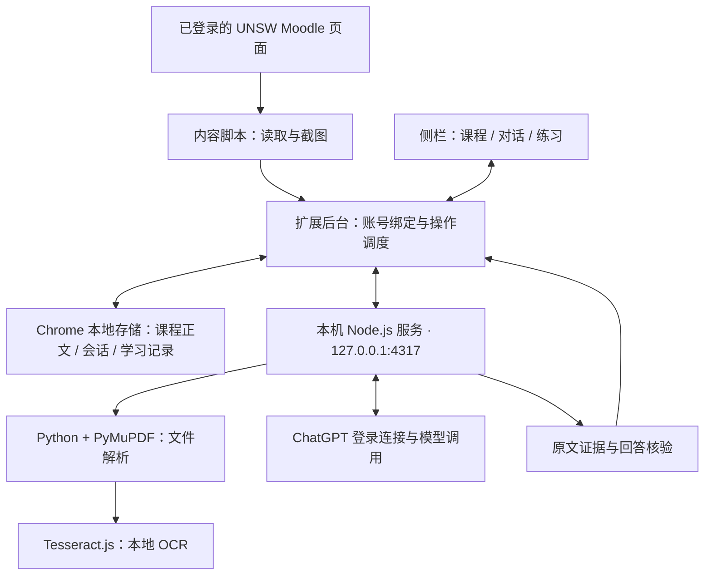

<p align="center">
  
</p>

<h1 align="center">Askme</h1>

<p align="center">
  面向 UNSW Moodle 的课程学习助手<br>
  同步课程 · 原文问答 · 截图理解 · 对话自测 · 复习计划
</p>

<p align="center">
  <a href="#核心功能">功能介绍</a> ·
  <a href="#快速开始">安装运行</a> ·
  <a href="#日常使用">使用指南</a> ·
  <a href="#系统架构">系统架构</a> ·
  <a href="#常见问题">常见问题</a>
</p>

---

## 项目简介

Askme 是一个为 **UNSW Moodle** 定制的 Chrome 扩展，把课程资料同步、知识提炼、连续问答和练习放在同一个学习侧栏中。

选择课程后，Askme 将可读取的页面和文件正文保存在本机。提问时检索相关摘录，通过 ChatGPT 生成回答，并展示可展开的原文依据。你可以接着追问、框选页面截图，或直接在对话中生成可点击的选择题。

项目关注的是：**减少查找资料和组织学习内容的操作，让答案有依据，让练习能回到课程知识。**

> Askme 是独立项目，专门适配 UNSW Moodle；不代表 UNSW、Moodle 或 OpenAI 官方产品。资料覆盖范围以实际同步结果为准。

## 当前版本

| 项目 | 当前实现 |
| --- | --- |
| 扩展版本 | **1.12.0** |
| 扩展构建 | `2026.10.04.3` |
| 本机服务 | `2026.10.04.chatgpt-plan.13` |
| 使用环境 | Windows、PowerShell 7、Chrome |
| AI 方式 | 在扩展设置中连接 ChatGPT 并选择可用模型 |
| 已验收模型 | `gpt-5.6-luna`，实际可选项以账号返回的模型列表为准 |
| 资料检索 | 本地关键词检索、BM25、周次范围判断与片段筛选 |

本版使用 ChatGPT 登录连接，不需要启动 Ollama。登录能否使用、可选模型及使用额度取决于账号授权和服务返回结果。

## 核心功能

| 功能 | 使用方式 |
| --- | --- |
| **选择课程并同步** | 从 Moodle 课程列表勾选课程，读取可访问的页面、静态说明和受支持文件 |
| **持久资料缓存** | 保存提取正文、来源链接、页码和校验信息；普通提问复用缓存 |
| **课程知识问答** | 在所选课程范围内检索，回答附来源编号与可展开的原文摘录 |
| **连续对话与历史** | 在同一会话继续追问，也可新建会话、恢复历史记录 |
| **知识提炼与总结** | 围绕当前问题整理课程概念、要点及复习内容 |
| **截图理解** | 框选当前页面，把截图附到问题中，询问公式、图示或页面内容 |
| **对话内选择题** | 输入出题请求，在聊天中打开测验卡，点选答案并查看判分、解析和来源 |
| **复习与学习计划** | 按知识点安排练习，记录经过原文核验的反馈，区分首次答对与后续复测 |
| **Assessment / quiz / exam 准备** | 回查课程要求、静态作业说明及日期，依据课程知识开展自测 |
| **同步明细** | 显示完整、部分读取、受限、失败和不支持格式，保留原页面查看入口 |

### 四个悬浮入口

进入 Moodle 后默认只显示悬浮按钮，点击后才展开面板。

| 入口 | 用途 |
| --- | --- |
| **Open panel** | 查看课程、选择同步范围、更新资料及查看读取明细 |
| **Open Askme session** | 打开课程问答，使用 Folder 切换课程并查看历史 |
| **Take screenshot** | 框选当前可见页面，将截图附到会话 |
| **Solve this page** | 讲解当前可读取页面的核心内容 |

侧栏使用上部渐变背景、下部白色阅读区域；宽度可调整。课程选择器、引用与自测均在学习界面内操作。

## 学习流程


### 可以这样提问

- “根据第 4 周资料，解释这一节的核心概念，并给出原文依据。”
- “这两个概念有什么区别？沿用刚才的课程资料继续说明。”
- “把这一节整理成复习提纲，标出材料没有说明的部分。”
- “根据这门课的资料出三道选择题。”
- “这张截图中的公式各项是什么意思？”
- “课程资料中这项作业的截止日期和提交要求是什么？”

这些是使用示例，不是预设答案。能否回答取决于所选课程已同步的材料。

## 快速开始

### 1. 准备环境

| 依赖 | 用途 |
| --- | --- |
| Chrome 116 或更高版本 | 加载 Manifest V3 扩展；最低版本声明见扩展清单 |
| PowerShell 7（`pwsh`） | Windows 启动脚本与本机凭据保护 |
| Node.js | 运行本机服务；开发环境已使用 Node.js 24 |
| Python 3 | 文件正文提取；需要 PyMuPDF 和 Pillow |
| Git、npm | 获取源码、按锁文件安装依赖 |
| Moodle 与 ChatGPT 账号 | 访问自己的课程，完成 AI 登录连接 |

以下步骤面向 Windows。当前启动器和凭据保护依赖 Windows，尚未提供经过验收的 macOS / Linux 部署流程。

### 2. 获取源码

仓库为私有，需要有访问权限的 GitHub 账号。

```powershell
git clone https://github.com/ElapsedChen/Askme.git D:\Askme
Set-Location -LiteralPath 'D:\Askme'
```

已经有本地项目时，进入原目录即可，不要在同一路径重复克隆。

### 3. 安装依赖

在仓库根目录运行：

```powershell
npm ci --prefix server
npm ci --prefix server/ocr-runtime --ignore-scripts --no-audit --no-fund
node server/ocr-runtime/prepare-data.mjs
```

为文件解析创建项目独立 Python 环境：

```powershell
python -m venv .runtime/python
& '.\.runtime\python\Scripts\python.exe' -m pip install PyMuPDF Pillow
```

OCR 准备脚本会把已安装语言包复制到本地目录。运行 OCR 时读取本机数据，不临时下载语言模型。具体边界见 [OCR 依赖说明](server/ocr-runtime/README.md)。

### 4. 加载 Chrome 扩展

1. 打开 `chrome://extensions`。
2. 开启“开发者模式”。
3. 点击“加载已解压的扩展程序”，选择仓库中的 `extension` 文件夹。
4. 查看 Chrome 显示的扩展 ID。
5. 将 [start-askme.ps1](start-askme.ps1) 中的 `$extensionId` 设置为该 ID；若已一致，无需修改。

扩展 ID 必须与服务允许的 ID 一致。不同安装路径或电脑上的解压扩展 ID 可能不同，不要直接假定它沿用原电脑的值。

### 5. 启动本机服务

在仓库根目录运行，指定前面创建的 Python 环境：

```powershell
$env:STUDY_PYTHON = (Resolve-Path -LiteralPath '.runtime/python/Scripts/python.exe').Path
pwsh -NoProfile -File .\start-askme.ps1
```

服务监听 `http://127.0.0.1:4317`。启动脚本会检查现有服务，并将日志写入 `logs/`。

后续从新的终端启动时，同样先设置 `STUDY_PYTHON`。已有环境也可以使用 [隐藏启动器](start-askme-hidden.vbs)，前提是该启动环境能找到正确的 Python 和依赖。

> `tools/register-autostart.ps1` 是原开发环境的自启动配置脚本，含机器路径。它不是新电脑安装的必需步骤，使用前需要调整为本机路径。

### 6. 连接账号并开始学习

1. 登录 `https://moodle.telt.unsw.edu.au/`。
2. 若刚加载或更新过扩展，刷新 Moodle 页面。
3. 点击 Askme 悬浮图标，在设置中选择“连接 ChatGPT”并完成登录。
4. 从实际返回的列表中选择模型。
5. 打开课程面板，选择需要的课程并同步。
6. 点击“开始学习”，或在会话中的 **Folder** 选择课程后提问。

首次同步请保持 Moodle 标签页和课程面板打开，等待读取结束。

## 日常使用

### 查资料与提问

先在 Folder 选择课程，再输入问题。答案下方的来源卡可以展开，查看本次使用的原文；需要完整上下文时，通过链接回到 Moodle。

遇到新主题可以新建会话；继续同一主题时直接追问。会话历史保存在本机，并按课程管理。

### 更新课程

教师新增或修改材料后，打开课程卡点击 **“更新资料”**。日常提问不需要先重新同步整门课程。

更新期间，已有会话仍可能保留当时使用的旧摘录。核对更新后的资料时，应等同步结束后再发起新问题。

### 练习与复习

在对话中请求生成选择题，打开测验卡后直接点击选项。知识点练习会提供经过来源核验的反馈，并用于后续复习安排。

首次答对与延迟复测是不同状态：系统不会因为一次答对或点击阅读，就宣称已经掌握。未通过核验的反馈不会计入掌握记录。

## 同步、格式与覆盖范围

| 资料类型 | 当前处理方式与边界 |
| --- | --- |
| Moodle 课程页面 | 提取静态正文、章节和嵌套列表，保留来源链接 |
| PDF | 按页提取文本；无文字页尝试有时间和页数预算的本地 OCR |
| DOCX / PPTX / XLSX | 提取文档段落、幻灯片或表格正文；不等同于理解其中全部图片或媒体 |
| TXT / CSV | 提取可读取文本 |
| 大型现代 Office 文件 | 条件满足时用 HTTP Range 获取正文 XML，避免传输内嵌媒体；依赖服务器提供稳定分段响应 |
| CAD 零件、模板、压缩包等 | 部分格式暂不支持正文提取，会显示具体状态 |
| 隐藏、受限或失效活动 | 记录访问限制或错误，保留原页面入口 |
| 正式测验作答、提交和评分区域 | 不作为课程正文同步；使用静态学习材料进行准备与自测 |

缓存保存的是**提取正文、来源、页码及校验信息**，不是所有原始 PDF/PPTX 的永久二进制备份。

完整缓存可以通过 ETag、Last-Modified 或内容摘要复用。部分读取和失败项不会被标成全部成功；可在课程卡的同步明细中查看原因，必要时重试。

### 已知限制

- OCR 只尝试识别文字，不能保证理解照片、工程图、复杂表格或全部公式。
- 图像页的低可信结果、超时和缺失文字会保留为资料缺口。
- 引用只能说明本次答案依据哪些摘录，不能证明整门课程已完整读取。
- Moodle 隐藏、受限或不存在的活动，插件无法自行恢复。
- 当前使用文本检索，不提供向量 embedding。
- ChatGPT 登录和模型可用性受账号、授权状态、网络及服务额度影响。
- 练习反馈用于辅助学习，不构成成绩保证或客观掌握认证。

## 系统架构



### 技术组成

| 层 | 实现 |
| --- | --- |
| 扩展 | Chrome Manifest V3、JavaScript、Shadow DOM、扩展本地存储 |
| 界面 | 课程面板、Folder、连续会话、引用卡、交互式测验 |
| 后台调度 | 账号/课程绑定、请求队列、超时处理、连接恢复 |
| 检索 | 结构化分段、BM25、候选筛选、周次判断、命中窗口 |
| 本机服务 | Node.js、HTTP 本地接口、ChatGPT 会话与凭据管理 |
| 文件解析 | Python、PyMuPDF、Office XML、Tesseract.js |
| 学习校验 | 连续原文证据、数值与技术标识核对、语义审核、来源版本绑定 |

## 数据与权限

- **本机保存**：课程正文缓存、会话历史和学习记录保存在 Chrome 扩展本地存储；文件解析与 OCR 在本机执行。
- **AI 请求**：提问时会发送必要的问题、对话历史、匹配课程摘录，以及主动附加的截图。
- **登录凭据**：由本机服务通过 Windows 当前用户保护机制保存，不随扩展 ZIP 或源码仓库发布。
- **本机接口**：服务只监听回环地址，并校验扩展来源和绑定信息。
- **浏览器权限**：清单含本地存储、侧栏及截图相关权限；当前 `host_permissions` 也含 `<all_urls>`。课程内容脚本的自动注入范围限定为 UNSW Moodle，声明权限的完整范围请查看 [manifest.json](extension/manifest.json)。
- **仓库隔离**：`.gitignore` 排除运行时凭据、课程缓存、日志、浏览器配置、临时输出和依赖目录。不要把真实课程导出、账号令牌或私人截图加入提交。

## 项目结构

```text
Askme/
├─ extension/                 # Chrome 扩展、界面、后台调度和本机缓存
│  └─ assets/                 # Askme Logo 与界面图标
├─ server/                    # ChatGPT 连接、回答核验与文件解析
│  ├─ chatgpt/                # 登录协议、会话和模型请求
│  └─ ocr-runtime/            # OCR 依赖、锁文件与语言数据准备脚本
├─ tests/                     # 扩展、解析器与学习规则测试
├─ evaluation/                # 离线评测及虚构样例
├─ quality/                   # 质量评测工具与金标模板
├─ tools/                     # 构建、打包和辅助工具
├─ start-askme.ps1            # 本机服务启动入口
├─ start-askme-hidden.vbs     # 隐藏启动入口
└─ README.md
```

`.runtime/`、`.work/`、`logs/` 和 `dist/` 属于本机运行或构建目录，不随源码提交。

## 开发与验证

下面命令从仓库根目录执行。它们是开发检查入口，不代表每次提交都已运行，也不能代替真实 Moodle 验收。

```powershell
# 后端协议、会话、凭据和学习模块测试
npm --prefix server test

# 检索与知识掌握规则的定向测试
node --test tests/learning-core.test.mjs tests/unit-progress.test.mjs

# Python 文件提取测试
& '.\.runtime\python\Scripts\python.exe' -m unittest discover -s tests -p test_extract.py
```

`tests/` 还保留部分历史版本测试，应先确认测试对象与当前实现相符。真实课程登录、同步覆盖、截图和模型回答需要单独验收，不能由单元测试或服务健康状态替代。

### 构建扩展包

```powershell
node tools/build-manifest.mjs
& '.\.runtime\python\Scripts\python.exe' tools/package-release.py
```

生成文件位于 `dist/`。打包工具核对 ZIP 文件清单与扩展目录的字节一致性。

**扩展 ZIP 只包含浏览器扩展。** 迁移到另一台电脑时，还需部署本机服务与依赖，并重新登录自己的账号。

### GitHub Actions

仓库首页的 **Suggested workflows** 是 GitHub 推荐的自动化模板；只有保存相应 workflow 配置后，才会按配置的事件触发运行。当前仓库尚未配置 GitHub Actions。

对于 Askme，后续可以按需接入代码检查、定向测试和扩展打包。自动发布 npm 包、Deno 测试等推荐项不是当前项目运行的必需条件。参见 [GitHub Actions 官方入门文档](https://docs.github.com/en/actions/get-started/quickstart)。

## 常见问题

<details>
<summary><strong>为什么连接了 ChatGPT 仍无法回答？</strong></summary>

确认已选择可用模型、本机服务正在运行，且当前课程已经同步。展开错误提示区分授权、额度、连接、超时或资料不足；“已登录”本身不代表每次模型请求都能成功。

</details>

<details>
<summary><strong>为什么同步后还有“待处理”或“不支持格式”？</strong></summary>

课程可能包含隐藏活动、失效链接、CAD 文件或无法可靠识别的图片页。打开课程卡的同步详情逐项查看；这些状态不表示已经完整读取，也不一定意味着扩展故障。

</details>

<details>
<summary><strong>是不是每次问答都要重新下载课件？</strong></summary>

不是。日常问答检索已经保存的正文。主动更新课程时才检查变化，可用缓存会尽量复用。

</details>

<details>
<summary><strong>为什么旧会话仍显示更新前的内容？</strong></summary>

历史消息保存了生成时使用的来源摘录，不会在同步后静默改写。等待资料更新结束，再发起问题核对新内容。

</details>

<details>
<summary><strong>扩展重载后面板失效或出现上下文错误怎么办？</strong></summary>

重新加载扩展后，需要刷新已打开的 Moodle 页面，让内容脚本重新连接后台。若仍有问题，查看 `logs/` 和扩展错误详情，并记录实际版本、操作步骤及错误文字。

</details>

<details>
<summary><strong>为什么在另一台电脑上不能只解压 ZIP 使用？</strong></summary>

ZIP 不包含本机 Node.js 服务、Python/OCR 依赖或登录凭据。请按“快速开始”部署，并确认 Chrome 实际扩展 ID 与启动器配置一致。

</details>

## 项目文档

| 文档 | 内容 |
| --- | --- |
| [正式交付说明](FINAL_RELEASE.md) | 当前版本使用方式、已知限制与验收边界 |
| [发布状态](RELEASE_STATUS.md) | 当前发布摘要及历史记录 |
| [发布校验](release-1.12.0.md) | 构建、打包和版本核对 |
| [产品设计](PRODUCT.md) | 项目目标与产品方向 |
| [功能设计](FUNCTIONAL.md) | 功能分解与行为设计 |
| [学习内核](LEARNING_KERNEL.md) | 知识、证据和学习流程 |
| [掌握度设计](MASTERY_DESIGN.md) | 练习反馈与复测规则 |
| [离线评测](evaluation/README.md) | 质量评测结构与虚构样例 |

设计文档和历史报告可能包含早期方案；部署时以当前源码、版本说明和实际界面为准。

---

**Askme · 从课程原文出发，把学习、提问与练习连在一起。**
